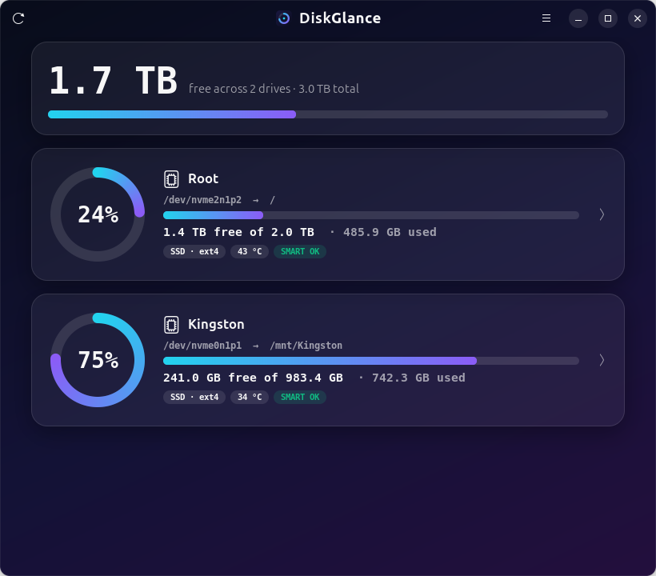

# DiskGlance

**See your disks at a glance.** A fast, good-looking disk-space viewer for Linux, built on
GTK4 + libadwaita. It blends the clarity of Windows 11's storage page with the power of
WinDirStat / Filelight / Baobab: instant overview first, one click to find what's eating space.

## Features
- **Overview** of every mounted drive: gradient ring, usage bar, free/used/total
- **Drill-down**: click a drive → live-scanned **treemap** + ranked folder list; click any block to dive deeper
- **Drive health**: temperature (sysfs) and SMART status (via UDisks2) — no root needed
- **Notifications** when a drive crosses 90% full
- Dark / light / follow-system themes, auto-refresh every 5 s (`F5` to force)
- Counts real disk usage (allocated blocks), never crosses into other mounts, counts hard links once
- Open straight into a folder: `diskglance /var`

## Install
Requires GTK 4.14+ and libadwaita 1.5+ with PyGObject (Ubuntu 24.04+, Fedora 40+, Arch, etc.):

    sudo apt install python3-gi gir1.2-adw-1    # Debian/Ubuntu (usually preinstalled on GNOME)
    git clone https://github.com/rickbme/diskglance && cd diskglance
    ./install.sh                                # per-user; adds app-menu entry + icon

Or just run in place: `./diskglance.py`. Remove with `./uninstall.sh`.

## Settings
`~/.config/diskglance/config.json` — theme, notifications, `warn` (default 80) and `crit` (default 90) thresholds.

## Roadmap
Background mode with tray alerts, file-type breakdown, delete/open-in-files actions, Flatpak package.

## License
MIT
