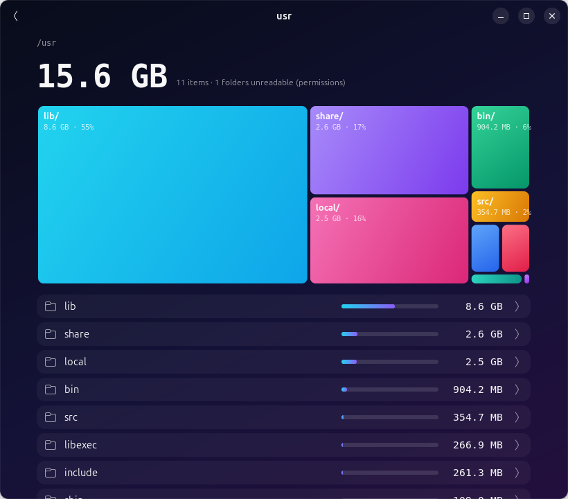

# DiskGlance

**See your disks at a glance.** A fast, good-looking disk-space viewer for Linux, built on
GTK4 + libadwaita. It blends the clarity of Windows 11's storage page with the power of
WinDirStat / Filelight / Baobab: instant overview first, one click to find what's eating space.

## Features
- **Overview** of every mounted drive: gradient ring, usage bar, free/used/total
- **Drill-down**: click a drive → live-scanned **treemap** + ranked folder list; click any block to dive deeper
- **Drive health**: temperature (sysfs) and SMART status (via UDisks2) — no root needed
- **Notifications** when a drive crosses 90% full (can be switched off)
- **Optional background mode** (off by default): closing the window keeps quietly watching; optional start-at-login. Nothing runs in the background unless you turn it on
- Dark / light / follow-system themes, auto-refresh every 5 s (`F5` to force)
- Counts real disk usage (allocated blocks), never crosses into other mounts, counts hard links once
- Open straight into a folder: `diskglance /var`

## Install
### Flatpak (any distro)
Download `DiskGlance-0.2.0.flatpak` from the [latest release](https://github.com/rickbme/diskglance/releases/latest), then:

    flatpak install --user DiskGlance-0.2.0.flatpak
    flatpak run io.github.rickbme.DiskGlance

Or build it yourself:

    flatpak install --user flathub org.flatpak.Builder org.gnome.Platform//51 org.gnome.Sdk//51
    flatpak run org.flatpak.Builder --user --install --force-clean build-dir io.github.rickbme.DiskGlance.yml
    flatpak run io.github.rickbme.DiskGlance

### From source
Requires GTK 4.14+ and libadwaita 1.5+ with PyGObject (Ubuntu 24.04+, Fedora 40+, Arch, etc.):

    sudo apt install python3-gi gir1.2-adw-1    # Debian/Ubuntu (usually preinstalled on GNOME)
    git clone https://github.com/rickbme/diskglance && cd diskglance
    ./install.sh                                # per-user; adds app-menu entry + icon

Or just run in place: `./diskglance.py`. Remove with `./uninstall.sh`.

## Settings
`~/.config/diskglance/config.json` — theme, notifications, `warn` (default 80) and `crit` (default 90) thresholds.

## Roadmap
File-type breakdown, delete / open-in-Files actions, Flathub listing.

## AI disclosure
This project was written with AI assistance (Claude).

## Credits
Made by [Rickbme](https://github.com/rickbme) · Dad's Fixit Shop (DFS). Icon and background are derived from the DFS logo artwork.

## License
MIT (code). The DFS logo artwork in `data/brand` and the app icon is © Rickbme / Dad's Fixit Shop.
